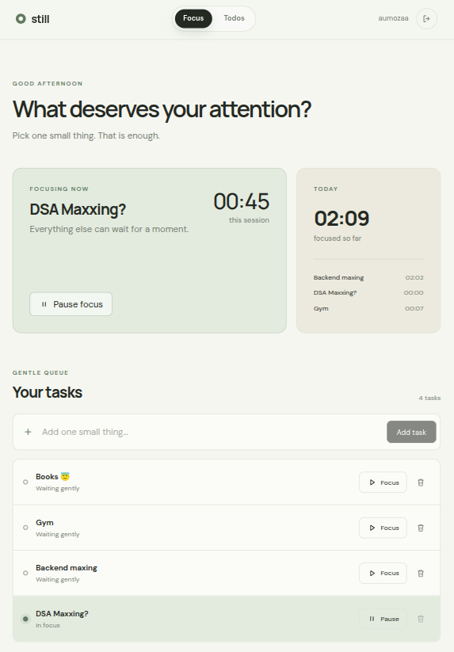
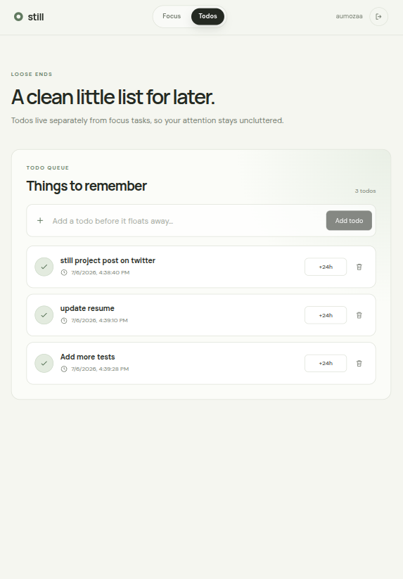

# Still - Focus Timer for ADHD Brains

  

A minimalist focus timer and task manager designed specifically for ADHD brains. Choose one thing to focus on—let everything else wait.

**Live (Frontend):** https://randomstill.online  
**Backend API:** https://randomstill.online/api  
**GitHub:** https://github.com/AumOzaa/still

---

## Tech Stack Overview

| Layer | Technologies |
|-------|-------------|
| **Frontend** | React 19, Vite, Socket.io-client, CSS3 |
| **Backend** | Node.js 22, Express 5, Socket.io |
| **Database** | Neon PostgreSQL (serverless) |
| **Caching** | Redis (client + rate limiting store) |
| **Authentication** | JWT, bcrypt |
| **Validation** | Zod |
| **Logging** | Winston |
| **Rate Limiting** | express-rate-limit + RedisStore |
| **Testing** | Jest, Supertest |
| **CI/CD** | GitHub Actions |
| **DevOps** | Docker |
| **Deployment** | Frontend: Vercel, Backend: AWS |

---

## Features

| Feature | Description |
|---------|-------------|
| **Single Focus Mode** | Prevents overwhelm by limiting active tasks to one at a time |
| **Real-time Timer** | Live focus session tracking with Socket.io synchronization |
| **Gentle Task Queue** | Zero-pressure task management, no streaks or guilt |
| **Expiring Todo List** | Temporary tasks with automatic expiration and +24h extension |
| **Daily Analytics** | Aggregate focus time by task with performance insights |
| **Real-time Updates** | WebSocket-powered instant feedback across sessions |

---

## Architecture & Design Patterns

### Backend Structure
```
adhd_brain/
├── config/           # Database (Neon) & Redis configuration
├── controllers/      # Business logic layer (auth, tasks, todos)
├── middleware/       # Authentication & rate limiting middleware
├── routes/           # REST API endpoint definitions
├── sockets/          # WebSocket event handlers (Socket.io)
├── utils/            # Logging (Winston), helper functions
├── validators/       # Zod validation schemas
└── app.js            # Express app initialization
```

### Key Implementation Details

- **Authentication**: JWT-based auth with Bearer token middleware
- **Rate Limiting**: Redis-backed rate limiters for auth (15min) and API (10min) endpoints
- **Real-time**: Socket.io rooms scoped to user IDs for targeted events
- **Database**: Neon PostgreSQL with connection pooling for serverless scalability
- **Validation**: Zod schemas for all inputs (task creation, todo, auth)
- **Error Handling**: Structured error responses with proper HTTP status codes
- **Logging**: Winston with JSON format and timestamped console output

---

## Getting Started

### Prerequisites

- Node.js 22.x
- PostgreSQL (Neon or local)
- Redis server
- npm or yarn

### Installation

```bash
# Clone repository
git clone https://github.com/AumOzaa/still.git
cd still

# Install backend dependencies
npm install

# Install frontend dependencies
cd frontend && npm install && cd ..

# Set up environment variables
cp .env.example .env
# Edit .env with your configuration
```

### Environment Variables

```env
NEON_CONNECTION_URI=your_postgresql_connection_string
NEON_TEST_CONNECTION_URI=test_database_connection
SALT_ROUNDS=10
JWT_SECRET=your_jwt_secret_key
REDIS_URL=redis://localhost:6379
PORT=3000
```

### Running Locally

```bash
# Start backend server
npm run dev

# Start frontend (in separate terminal)
cd frontend
npm run dev
```

### Running Tests

```bash
npm test
```

### Docker Deployment

```bash
docker build -t still .
docker run -p 3000:3000 --env-file .env still
```

---

## API Endpoints

### Authentication
| Method | Endpoint | Description |
|--------|----------|-------------|
| POST | `/api/auth/signup` | Create new user account |
| POST | `/api/auth/signin` | User login (returns JWT) |

### Tasks
| Method | Endpoint | Description |
|--------|----------|-------------|
| GET | `/api/tasks/tasks` | List user's tasks |
| POST | `/api/tasks/createtask` | Create new task |
| POST | `/api/tasks/task/:id` | Start/stop task timer |
| POST | `/api/tasks/dayAnalytics` | Daily focus time analytics |
| POST | `/api/tasks/timeSinceStart` | Current session duration |
| DELETE | `/api/tasks/del/task/:id` | Delete a task |

### Todos
| Method | Endpoint | Description |
|--------|----------|-------------|
| GET | `/api/todos/todo` | List active todos |
| POST | `/api/todos/todo` | Create new todo |
| POST | `/api/todos/todo/:id` | Mark todo complete |
| POST | `/api/todos/todo/extend/:id` | Extend deadline by 24h |
| DELETE | `/api/todos/todo/:id` | Delete todo |

---

## CI/CD Pipeline

**GitHub Actions** (`/.github/workflows/node.js.yml`):
- Automated testing on push/PR (Node.js 18, 20, 22)
- Build validation
- Docker image building and pushing to Docker Hub

---

## Deployment Architecture

| Component | Platform | Details |
|-----------|----------|---------|
| Frontend | Vercel | Static React build with Vite |
| Backend | AWS | Node.js/Express server |
| Database | Neon | PostgreSQL serverless |
| Caching | Redis Cloud/Local | Rate limiting & sessions |

---

## Contribution Guidelines

Contributions are welcome! Please follow these steps:

1. Fork the repository
2. Create your feature branch (`git checkout -b feature/AmazingFeature`)
3. Commit your changes (`git commit -m 'feat: add some amazing feature'`)
4. Push to the branch (`git push origin feature/AmazingFeature`)
5. Open a Pull Request

---

## License

This project is licensed under the ISC License.

---

## Contact

**Aum Ozaa**  
GitHub: [@AumOzaa](https://github.com/AumOzaa)

---

## Screenshots

### Focus Dashboard


> Single task focus with real-time timer. Everything else waits while you give your attention to one thing.

### Todo List


> Temporary tasks with expiration dates. Extend by 24 hours or let them expire - no guilt, just clarity.

---

## Acknowledgments

Designed with ADHD focus challenges in mind:
- **Cognitive load reduction**: Single-task limitation prevents overwhelm
- **Gentle UX**: No streaks, no guilt, no pressure
- **Attention framing**: Clear visual feedback on focus time
- **Working memory support**: Todo list for "later" with expiration
